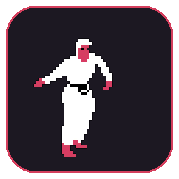

# GuyDances

[](https://github.com/RonaldoNazo/GuyDances/actions/workflows/build.yml)

A tiny pixel guy who lives on your desktop. He shows up when a music app starts
playing, dances, and disappears when the music stops.

<p align="center">
  
</p>

## Install from a release (no build needed)

Grab the latest files from
[Releases](https://github.com/RonaldoNazo/GuyDances/releases).

### Ubuntu / Debian

```bash
sudo apt install ./guydances_<version>_amd64.deb
```

Then launch **GuyDances** from the app grid. To also start him at login:

```bash
mkdir -p ~/.config/autostart
cp /usr/share/applications/guydances.desktop ~/.config/autostart/
echo 'X-GNOME-Autostart-enabled=true' >> ~/.config/autostart/guydances.desktop
```

### Other Linux (X11)

```bash
tar xzf guydances-<version>-linux-x86_64.tar.gz
cd guydances-<version>-linux-x86_64
./install.sh              # or ./install.sh --autostart
```

Or run `./guydances` straight from that folder without installing anything.

### Windows 10/11

Download `guydances-<version>-windows-x64.zip`, unzip it, and double-click
`guydances.exe`. Windows may show a SmartScreen warning because the exe is
unsigned: click **More info → Run anyway**.

### Remove

```bash
sudo apt remove guydances
```

For the tarball install:

```bash
rm -f ~/.local/bin/guydances \
      ~/.local/share/applications/guydances.desktop \
      ~/.local/share/icons/hicolor/256x256/apps/guydances.png \
      ~/.config/autostart/guydances.desktop
```

## Use

Build first (see below), then install the Linux build:

```bash
./install-linux.sh              # ~/.local/bin + app-grid entry
./install-linux.sh --autostart  # same, and start at login
```

Or just run `./dist/guydances` without installing it.

- **Windows:** build it, then copy `dist/guydances.exe` to the machine and
  double-click it.

Left-drag him anywhere. Right-click him for:

- **Pause / Resume** — freezes him in place; resume and, if nothing is playing,
  he leaves.
- **Stop** → **1 / 2 / 4 / 8 hours** — hides him for that long.
- **Quit**.

Music stops or is paused → he disappears after about 2 seconds. Launching the
app again while he is snoozed cancels the snooze (it does not start a second
copy).

The Linux build needs an **X11 session** (Ubuntu on Wayland cannot keep a
frameless window on top).

## How "music" is detected

It watches which media apps are producing sound, not what the sound is. Browsers
(YouTube), Spotify, VLC, mpv, Rhythmbox and friends count. Native Teams,
Discord, Slack and notification chimes do not. A talk video in a browser still
counts as music — that is the accepted trade-off.

No microphone, no audio recording, no network.

## Build

Linux:

```bash
sudo apt install cmake libpulse-dev libx11-dev libgl-dev libxrandr-dev \
  libxinerama-dev libxcursor-dev libxi-dev libxext-dev libxrender-dev \
  libxfixes-dev
./build-linux.sh
```

Windows, cross-compiled from Linux:

```bash
sudo apt install mingw-w64
./build-windows.sh
```

The sprite in `assets/dance.bin` is generated from `guydances.mp4`:

```bash
python3 tools/extract_sprite.py   # needs ffmpeg + Pillow
```

## Dev flags

- `--demo` — stay visible without music.
- `--debug` — print audio detection changes to stderr.

The Windows build is cross-compiled and has not been run on Windows yet; treat
it as a preview until it has been tried on the laptop.
